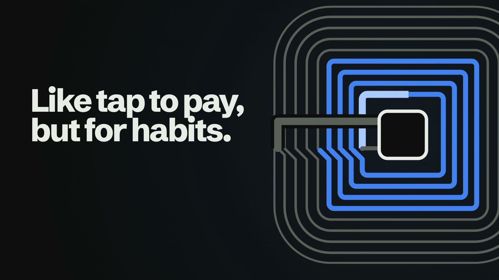

# taplog

A habit log you feed by tapping NFC stickers with your phone. Hold the phone to the sticker on your water bottle, and that's one more glass today.



It's a personal tool, made for one person. The code is public so you can read it or run your own copy. The app's [guide](https://taplog-lemon.vercel.app/guide) shows every step, from writing a sticker to tapping it.

## What it does

- Each habit is a **goal** (water, 8 a day) or a **limit** (smokes, at most 15), counted per day or per week. A limit can also ask for time between taps.
- Today shows each habit as a coil that winds one turn per tap. Turns past a limit go red.
- No sticker nearby? Hold a habit's coil on Today to add a tap by hand.
- Each habit has its own page with its history, its stickers and its settings.
- A goal that falls behind its pace sends a reminder, between 08:00 and 22:00 and at most once every 3 hours for each habit.

## How a tap works

1. A sticker holds a link like `https://your-app/t/<token>`. The token is 16 random bytes. The database keeps only its hash.
2. The phone reads the sticker and opens the link. `/t/<token>` logs one tap for the sticker's habit and sends you to `/logged`, which shows the new count and offers Undo for 2 minutes. A second tap within 30 seconds counts once.
3. A **silent** sticker holds no link. An iPhone Shortcuts automation sends a POST to the same link and shows the answer as a notification ("Water, 6 of 8. 2 to go."), so no browser opens.

Anything that opens a sticker's link logs a tap, a chat app's link preview included. Never paste one into a chat.

## Built with

- [Next.js](https://nextjs.org) 16 and React 19, on [Vercel](https://vercel.com)
- [Supabase](https://supabase.com): Postgres with row-level security, sign-in with an emailed code, and `pg_cron`, `pg_net` and Vault for the reminder job
- [web-push](https://github.com/web-push-libs/web-push) for reminders, [GSAP](https://gsap.com) for motion, [Tailwind CSS](https://tailwindcss.com) 4
- [Schibsted Grotesk](https://github.com/schibsted/schibsted-grotesk) by Bakken & Bæck and Henrik Kongsvoll (SIL Open Font License), loaded through `next/font`

## Run your own

You need Node 24, pnpm, the [Supabase CLI](https://supabase.com/docs/guides/local-development/cli/getting-started), Docker for the local database, a Supabase project and a Vercel account. For stickers: an iPhone, NTAG213 NFC stickers and the NFC Tools app.

### Locally

```sh
pnpm install
supabase start      # the local Supabase stack, in Docker
supabase db reset   # the migrations, then supabase/seed.sql
```

Create `.env.development.local`, taking the keys from `supabase status`:

```
NEXT_PUBLIC_SUPABASE_URL=http://127.0.0.1:54321
NEXT_PUBLIC_SUPABASE_PUBLISHABLE_KEY=<Publishable key>
SUPABASE_SECRET_KEY=<Secret key>
SIG_SECRET=<any random string>
```

Run `pnpm dev`, open http://localhost:3000 and sign in as `dev@taplog.local`. The code arrives in the local mail viewer, Mailpit, at http://127.0.0.1:54324. The seed gives that user three habits with stickers: http://localhost:3000/t/local-water-sticker-01 logs a water tap.

Checks: `pnpm test` (the logic in `lib/`), `supabase test db` (the database, `supabase/tests/`) and `pnpm lint`.

### Supabase

1. Create a project, then `supabase link --project-ref <your-project-ref>` and `supabase db push` to apply the migrations.
2. In Authentication, change the Magic Link email template so it carries only the code, for example `Your taplog code is {{ .Token }}`. The sign-in form asks for the code; a link in the mail spends the same one-time token, so a mail scanner opening it would void the code.
3. Turn off "Allow new users to sign up", then add yourself under Users. The app never creates an account.
4. Supabase's built-in mailer only sends to your project's team, and (at the time of writing) 2 emails an hour. For daily use, add your own SMTP server in the Authentication settings.

### Vercel

Import the repository. `vercel.json` runs the functions in `arn1` (Stockholm); change it to the region nearest your database. Then set these environment variables:

- `NEXT_PUBLIC_SUPABASE_URL`: the Supabase project's URL.
- `NEXT_PUBLIC_SUPABASE_PUBLISHABLE_KEY`: the publishable key, `sb_publishable_…`. Safe in the browser: row-level security guards the data.
- `SUPABASE_SECRET_KEY`: the secret key, `sb_secret_…`. It bypasses row-level security, so it stays on the server.
- `SIG_SECRET`: any long random string (`openssl rand -base64 32`). It signs the `/logged` links; the build stops without it.
- `NEXT_PUBLIC_VAPID_PUBLIC_KEY` and `VAPID_PRIVATE_KEY`: the push key pair, from `pnpm exec web-push generate-vapid-keys`.
- `CRON_SECRET`: any long random string. The reminder job sends it; without it the route refuses every call.
- `VERCEL_PROJECT_PRODUCTION_URL`: set by Vercel. On another host, set it to the app's host, without `https://`.

Preview deployments read whichever database their variables point at. If that's the production one, give `VAPID_PRIVATE_KEY` and `CRON_SECRET` to Production only, so a preview never sends a reminder. Leave `DESIGN_PREVIEW` unset outside your machine: `DESIGN_PREVIEW=1` turns on the `/preview` pages built from fixtures, for screenshots.

### Reminders

The last migration schedules a job that calls `/api/remind` every 15 minutes. It sends nothing until Vault holds the address and the secret. In Supabase's SQL editor:

```sql
select vault.create_secret('https://<your-host>/api/remind', 'remind_url');
select vault.create_secret('<your CRON_SECRET>', 'cron_secret');
```

Each call's answer lands in `net._http_response`; a 200 means it ran. Reminders are turned on per device, in Today's footer, and per habit, in its settings. On an iPhone only the Home Screen app can get them (Share, then Add to Home Screen).

### Stickers

On a habit's page, under Add a sticker, name it and press Add. The link is shown once, with the steps for either kind; the Silent switch picks which.

- **Browser sticker:** in NFC Tools, Write, Add a record, URL. Paste the link, tap Write and hold the phone to the sticker. Don't lock it, so it can take a new link later. Tap it once to check that it logs.
- **Silent sticker:** leave it blank. In Shortcuts: Automation, +, NFC. Scan the sticker, then Run Immediately. Add Get contents of URL, paste the link and set Method to POST. Add Show notification with Contents of URL, and name it taplog. Tap the sticker once: the notification shows the count.

Metal behind a sticker stops it working, and so does a foil liner.

## Limits

- **One person.** There's no sign-up; you add your account by hand. Every row belongs to a user and row-level security keeps users apart, but nothing else is built for a second person.
- **Oslo time.** What counts as today, weeks starting on Monday and the reminders' waking hours all follow Europe/Oslo, whatever the device's time zone.
- **Tested on an iPhone** with Chrome as the default browser, and in Chrome on a Mac. Other browsers may work, but haven't been tried.
- taplog counts what you tap. It isn't medical advice.

## License

Built as a personal tool and shared under the [MIT License](LICENSE): free to use and change, as is, with no support or warranty. Issues are open, but no reply is promised.
